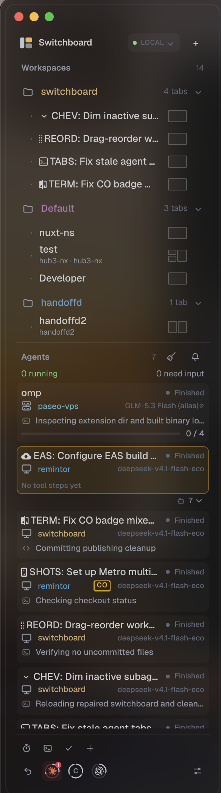
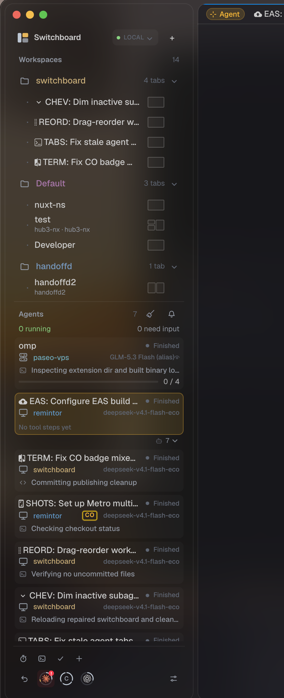

# Switchboard

A herdr-style visual sidebar for Tern that puts every workspace, tab and coding agent in one
place: OMP, Claude Code, Codex, pi, OpenCode and other harnesses, local or on a VPS, with live
state, progress and provider quota rings.

<p align="center">
  
</p>

## Highlights

- **One list for every agent**, across all connected hosts, with a host badge, project color, model, state (running, needs input, idle, done) and the current step.
- **Live OMP detail**: tool steps, todo progress bars, subagent trees you can expand and jump into, and sessions that survive `/new`.
- **Other harnesses too**: Claude Code, Codex, pi, OpenCode, Grok Build and similar are detected in plain terminal panes and shown with their brand icon.
- **Workspaces that follow the host**: switch the host chip and the workspace list follows; every click switches to the owning machine first, so new sessions never start on the wrong one.
- **Provider quota rings** from `omp usage`, with time left until each reset.
- **Quiet notifications**: macOS alerts for finished or blocked agents, only while Tern is in the background.
- **Keyboard first**: next/previous agent, jump to agent 1-9, new chat tab, toggle sidebar.

## Anatomy

<table>
  <tr>
    <td width="420"></td>
    <td valign="top">

1. **Header**: the host chip (`LOCAL` / `VPS`; click to switch host) and the new-workspace button.
2. **Workspaces**: your Tern sessions with their tabs and layout thumbnails. Recent ones sort first; drag to reorder; hover to close.
3. **Agents**: the pin button in the header opens a card board of pinned agents, then one card per running agent: title, host, project, model, state and the latest step or todo bar. Closed agents stay dimmed until you sweep them with the broom.
4. **Summary line**: running and needs-input counts.
5. **Footer**: pinned plugin shortcuts in a sideways-scrolling row, then a separate grid button whose hover card holds built-in Tern blocks as three category columns of icon tiles (task manager, board, git and more) that open as centered overlays (⇧⌘↵ expands, Return to split makes a real block), then the add button. Provider quota rings and settings sit below.

    </td>
  </tr>
</table>

## Install

```sh
tern plugin install github.com/Aft1n/switchboard
```

Quota rings and OMP agents need OMP installed. Other coding harnesses are detected without it.

## Update

```sh
tern plugin install github.com/Aft1n/switchboard --force
```

`--force` replaces the installed copy with the latest `main`; Tern reloads the daemon's plugins after the install. If the sidebar still shows the old build, reload it:

```sh
tern plugin reload switchboard
```

Check the loaded version with `tern plugin list`.

For a checkout you linked for development, pull and reload instead:

```sh
tern plugin reload switchboard
```

To remove it: `tern plugin remove switchboard`.

## Workspaces

- Every Tern session is a workspace. Workspaces touched in the last 24 hours sort first, newest first: switching into one, opening a tab in it, or an agent working there refreshes it.
- Reorder by dragging: hover a workspace, click its grip (the folder icon), then click the row it should go above. Click the grip again to cancel. Your order wins for the workspaces it lists; new ones append.
- Hover a workspace and click its x to close it. A workspace with open tabs asks first, because closing ends their programs.
- Workspaces with parked panes show a count badge; hover it for a card of the parked blocks (Tern's kind names and folders), and click one to unpark it into that workspace.
- Switchboard keeps a tree history: if a Tern reset drops projects, a "Restore saved tree" button in Workspaces (or the palette command) recreates them from the last known folders; agent tabs return as resumable Closed cards.
- Each project name gets one of 36 colors, shared by its workspace row and its agent cards. Red is never used, since it means urgent or needs input.

## Agents

- Agents from every host are listed together, with a host badge. Each card shows title, host, project, model and state: running, needs input, idle, done or failed.
- Agents you have seen are remembered across reloads (newest first, up to 50). An agent's identity is its OMP session id, so a resumed session stays one entry.
- Other coding harnesses (Claude Code, Codex, pi, OpenCode and similar) in terminal panes are listed too, best-effort: local panes by a process scan, remote panes by their titles. Their states come from screen activity, so treat "running" as approximate.
- Rows move only on real state changes (first seen, running, needs input, finished). Transcript updates never reorder them, and agents that need input stay pinned at the top.
- Closed agents stay in the list, dimmed. Click one with a session id to reopen it with `omp --resume`. The broom in the Agents header clears closed entries; it never touches running agents.
- Pin an agent from the pin button on its card, or pin an already-closed agent from its Closed card. The pin button in the Agents header carries the pinned count; click it to open a board of detailed pinned cards (agent name, project, state, current step or todo; model and folder are in the hover tooltip). The cards fill the sidebar width and wrap into columns only when there is room for the names. A live card focuses its pane; a closed card with a session reopens with `omp --resume`. Unpin from the board. Pins are kept across reloads and tab closes, and the broom leaves them alone.
- Subagents: a parent with children shows a footer with the child count (and how many are running). Expand it to see the children indented beneath. Click a child to focus its thread in the parent's agent pane, and "Back to the main session" returns. Children are found from OMP task ids, never by name.
- `/new` in OMP starts a new session in the same pane. Switchboard keeps the pane where it is and moves the previous session to Closed, where a click reopens it with `omp --resume`.
- For a guaranteed parallel chat, use `alt+shift+n`: it starts a fresh omp process in a new tab and never touches the chat you are in.

### Other harnesses

| Harness | Icon | Detection |
| --- | --- | --- |
| Claude Code, Codex, OpenCode, Grok Build, Gemini CLI, Cursor Agent, Kimi, Qwen Code | Tern's brand icon | local: process scan (`/bin/ps`, matched to the pane by `TERN_PANE`); remote: pane title |
| pi | π | same |
| Aider, Amp, Goose, Crush, Droid | generic sparkle | same |

States are inferred from screen text: changing output is running, a trust or yes/no prompt is needs input, otherwise idle; running to idle becomes done. Treat them as approximate. Limits: remote Codex panes are not detected, and closed entries from these harnesses are listed but cannot be resumed. OMP rows keep their own title glyph.

## Notifications

On macOS, "Finished", "Failed" and "Needs your input" notifications are sent only while Tern is not the frontmost app. Heuristic harness agents are rate limited to one notification per pane and kind every two minutes.

## Quota rings

Provider limits come from the local `omp usage` command and show as rings with the
time left until each reset. Refresh from the palette (`Switchboard: refresh provider
quotas`) or by clicking the quota segment in the status bar.

## Sidebar

- The Workspaces/Agents split is draggable and saved across tabs.
- Toggle with `alt+shift+s` or `Toggle Switchboard sidebar` in the palette. `Restore Tern sidebar` hides it and keeps its width.
- Tern has no scroll API for plugin UI and each tab keeps its own scroller offset, so the focused workspace tab is pinned to the edge of the Workspaces scroller and always stays visible. The Agents list is not auto-scrolled: pick an agent and it moves up as it works.
- Subagent disclosures open instantly; the sidebar block flips them locally and the window saves the state.

## Remote hosts

Commands, keys, layout and styling run on the machine showing the window, and they
apply to remote panes too.

- Workspaces follow the host chip: with a host selected, Workspaces shows that host's projects (plus any without a host). Agents stay unified across all hosts.
- Every workspace, tab and agent action switches to the owning host first, so a new session never starts on the wrong machine. If that host is not connected, Switchboard shows a toast and does nothing.
- A remote host without the plugin still gets a sidebar: the window draws it as a canvas. Use `Switchboard: local host` in the palette to switch back to your own machine.

## Keyboard shortcuts

| Key | Action |
| --- | --- |
| `alt+j` / `alt+k` | Next / previous agent |
| `alt+shift+1` … `alt+shift+9` | Jump to agent 1–9 |
| `alt+shift+n` | New omp chat in a new tab |
| `alt+shift+s` | Toggle the sidebar |
| `alt+/` | Show the shortcut guide |

## Development

```sh
tern plugin link ~/Developer/switchboard   # run the checkout in place
tern plugin reload switchboard             # after edits
luau spec/run.luau                         # the test suite
luau usage_spec.luau                       # one spec file
tern plugin types .                        # writes tern.d.luau for luau-lsp (gitignored)
```

- `window.luau`: sidebar lifecycle, navigation, host routing, session discovery and shortcuts.
- `sidebar-host.luau`: the per-tab sidebar block.
- `view.luau`, `switchboard.css`: sidebar UI.
- `model.luau`: builds workspaces and agents from Tern's state.
- `agent_history.luau`, `agent_sessions.luau`: remembered agents and the `tern inspect` parser.
- `terminal_agents.luau`: finds other coding harnesses in terminal panes and infers their state from screen text.
- `project_colors.luau`, `workspace_order.luau`, `workspace_recency.luau`: persisted sidebar order and colors.
- `usage.luau`, `executable.luau`: quota normalization and omp/tern lookup.

Release notes are in [CHANGELOG.md](CHANGELOG.md). Licensed under the [MIT License](LICENSE).
